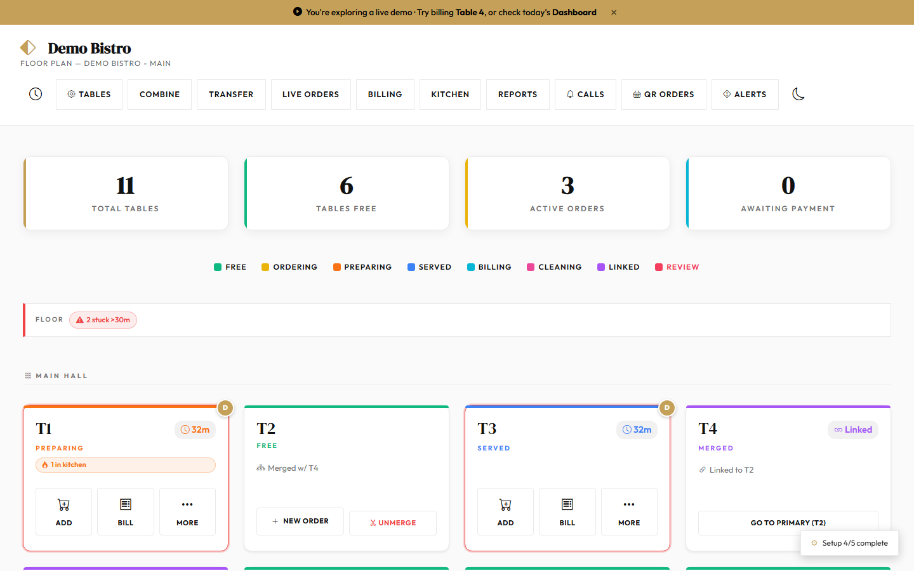
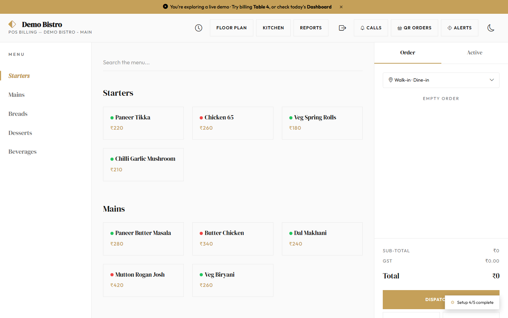
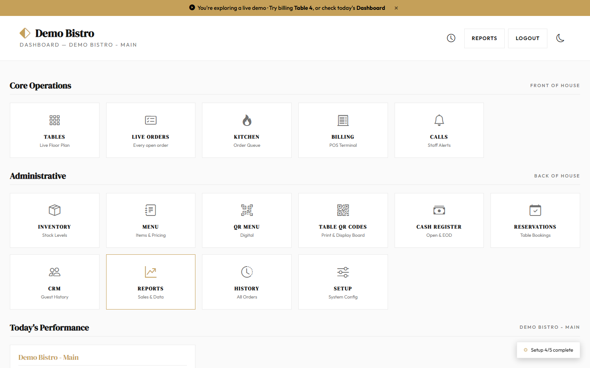
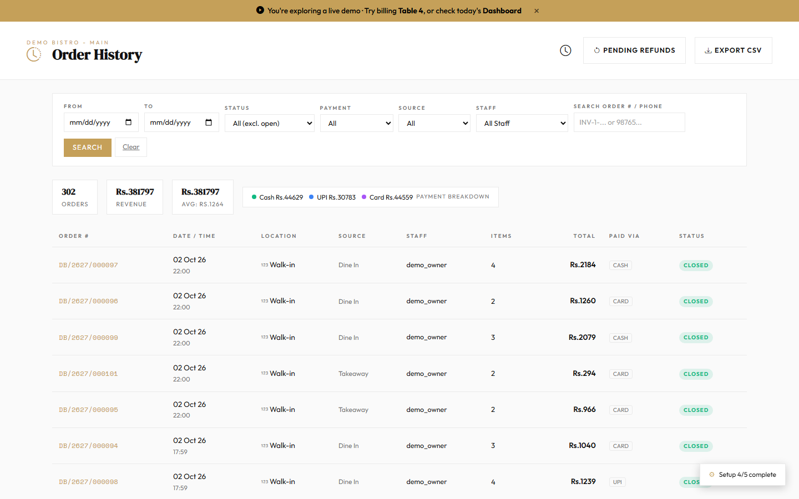
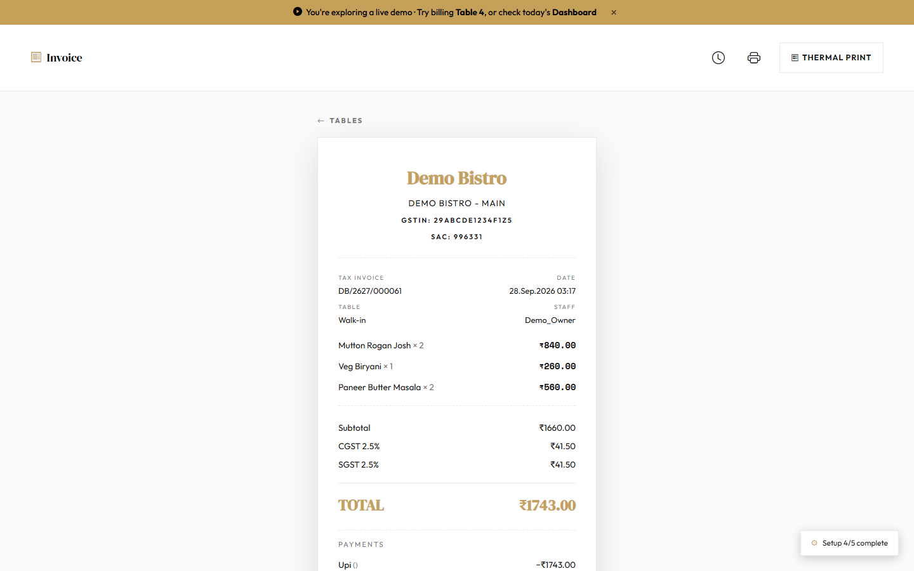
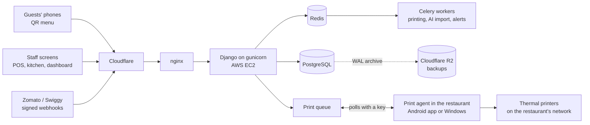

# Rasova: a restaurant POS, built and run solo

Rasova is a cloud point-of-sale and restaurant management system for Indian restaurants: fine dining, quick-service counters and cafés. I designed, built, tested, deployed and run it on my own, alongside a full-time job.

**Live demo:** [rasova.net/live-demo](https://rasova.net/live-demo/) opens a sample restaurant with no sign-up. Try billing a table, then open the dashboard.

The full source code is private. This repository is a guided tour: what the product does, how it is built, and a few real files from it. I am happy to walk through the whole codebase on a call, or give read-only access on request.

## At a glance

| | |
|---|---|
| Built | March 2026 to now, about 550 commits |
| Code | about 69,000 lines of Python (excluding migrations), of which about 33,000 are tests |
| Tests | 1,869 automated tests, run on every push; the build fails on any failure or lint error |
| Stack | Django 6, PostgreSQL, Celery and Redis, nginx and gunicorn on AWS EC2, Cloudflare, Cloudflare R2, GitHub Actions |
| Also | an Android app (Kotlin) and a Python agent that drive the restaurants' thermal printers |
| Integrations | Razorpay payments, Gemini (AI menu import from a photo), Zomato and Swiggy order webhooks, WhatsApp bills |

## What it does

- **Tables and orders:** a live floor plan, orders with modifiers and notes, table merge and transfer, QR ordering from the table, a waiter-call button.
- **Kitchen:** kitchen tickets routed to the right station's printer, and a live kitchen display.
- **Billing:** split bills, part payments, UPI QR codes, cash that works offline and syncs later, discounts and refunds with approval.
- **GST that a CA can sign off:** tax invoices and bills of supply, bill numbers within the legal 16 characters, and a GSTR-1 export with every table a restaurant files (B2CS, 8, 12, 13 and 14).
- **Counter mode:** token ordering, pay first, and the bill and all kitchen tickets printed on one strip.
- **Reports:** sales, items, staff, payments and profit, counted by the restaurant's business day (a night that ends at 2 am belongs to the day it started).
- **Multi-tenant:** many restaurants and outlets on one system, each seeing only its own data, with roles from owner to chef and per-outlet feature switches.

| | |
|---|---|
|  |  |
|  |  |

## How it is built

The printers sit on the restaurant's own network, where a cloud server cannot reach them. So the server only queues print jobs, and a small agent inside the restaurant (an Android app on a phone, or a Python service on a PC) collects them and prints over the local network. The agent restarts itself if it crashes, and authenticates with a key in a header.

## Engineering I'm proud of

**One tax engine, tested from four sides.** Every number on every bill comes from one module. It is checked by:
- 5,000 recorded "golden" bills (and 1,000 pub bills with liquor) that must not change unless a rule changes on purpose;
- Hypothesis property tests: rules like "the bill adds up" and "CGST and SGST split the GST evenly", tried on thousands of random bills;
- a second, independent implementation that has to agree with the engine to the paisa;
- a JavaScript copy, used by the in-browser cart, that is tested against the Python engine.

The engine itself stays private; [a sample of the property tests](samples/tests/test_bill_properties.py) is here.

**Correct under concurrency.** Two cashiers can bill on two screens at the same moment. Bill numbers come from a per-outlet series locked inside the transaction, so no number is ever repeated or skipped ([bill_numbers.py](samples/bill_numbers.py)). This is tested with real threads against real PostgreSQL row locks ([test_concurrent_billing.py](samples/tests/test_concurrent_billing.py)). A paid bill is locked the same way, so a late edit from another screen is refused rather than silently changing a settled bill.

**Security, checked line by line.** An outside reviewer read the code in October 2026. I checked every point against the code, fixed the real ones with a test that fails on the old code, and wrote down why the others were wrong. Among the fixes:
- the visitor's IP is believed only from our own proxy and Cloudflare's address ranges ([client_ip.py](samples/client_ip.py));
- webhooks are signed together with a timestamp, so a captured request can't be replayed later, and a repeated order is answered without being created twice ([aggregator_webhook.py](samples/aggregator_webhook.py));
- rate limits count each table separately, not each Wi-Fi network, so one busy restaurant can't lock out its own guests ([rate_limit_keys.py](samples/rate_limit_keys.py)).

**Measured, not guessed.** A k6 load test on a lab copy sized like the production server found how many restaurants it can carry, and found a kitchen-display query that grew with every ticket a restaurant had ever printed (one query per ticket: nearly 12 seconds per refresh at 10,000 tickets). It was fixed with a benchmark before and after.

**Kept clean on purpose.** Lint runs in CI and fails the build on dead code. Every deploy runs the database migrations, checks the site answers, and checks the backup archive is healthy.

## Code samples

The [samples](samples/) folder holds six files exactly as they are in production, each with a note on why it is there. They are for reading: each one imports from the rest of the private codebase.

## About me

I'm Rajath, a Python full-stack developer and trainer in Bengaluru. Rasova is where I practise building software properly: small commits, a test for every bug, plain-language docs, and fixing the cause rather than the symptom.

If you'd like a walkthrough of the code, a deeper look at any part, or read-only access to the full repository, message me on [LinkedIn](https://www.linkedin.com/in/rajath-r-2k2).

---

The text, screenshots and code in this repository are shared for viewing only. All rights reserved.
